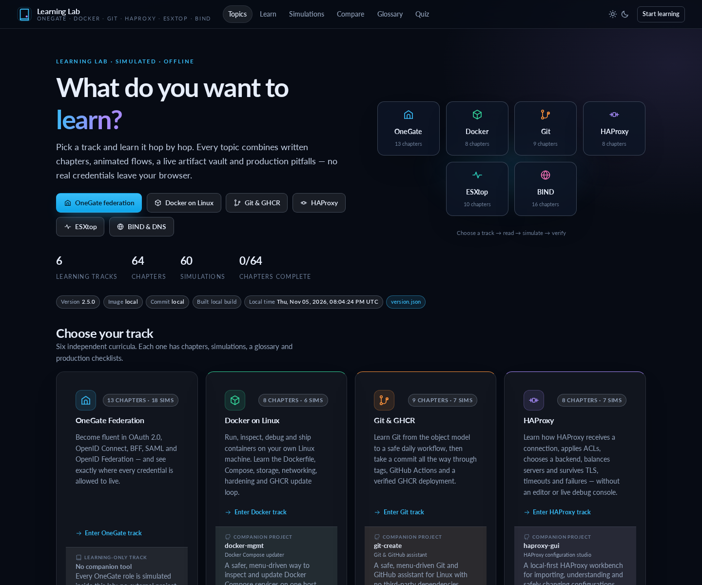
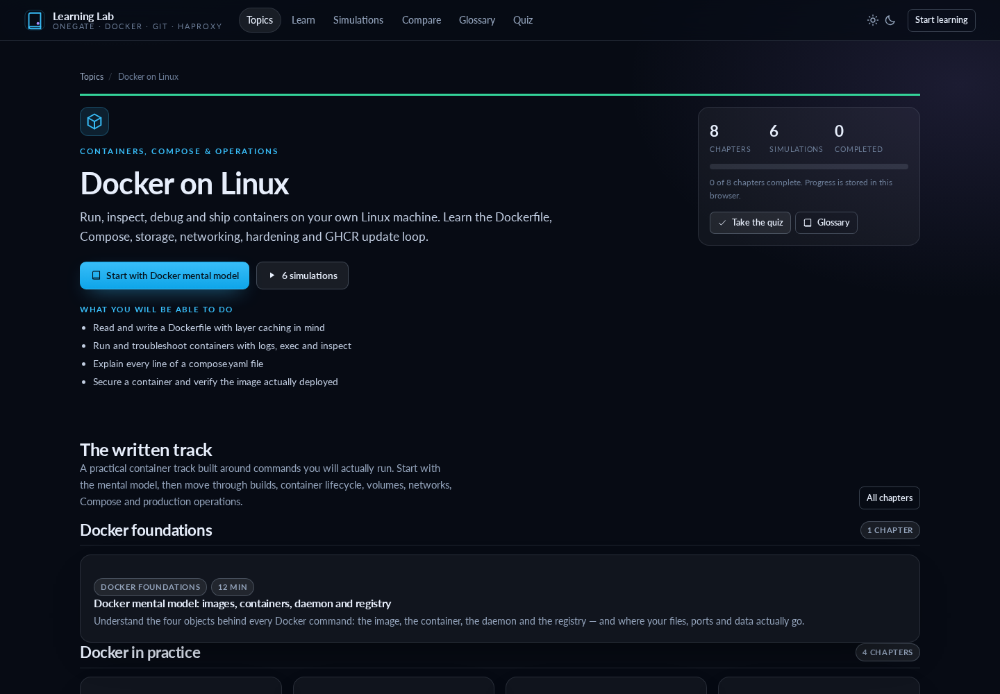
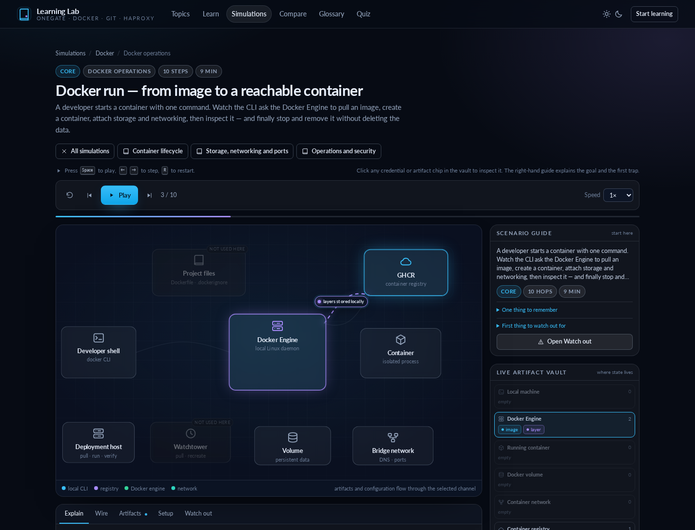
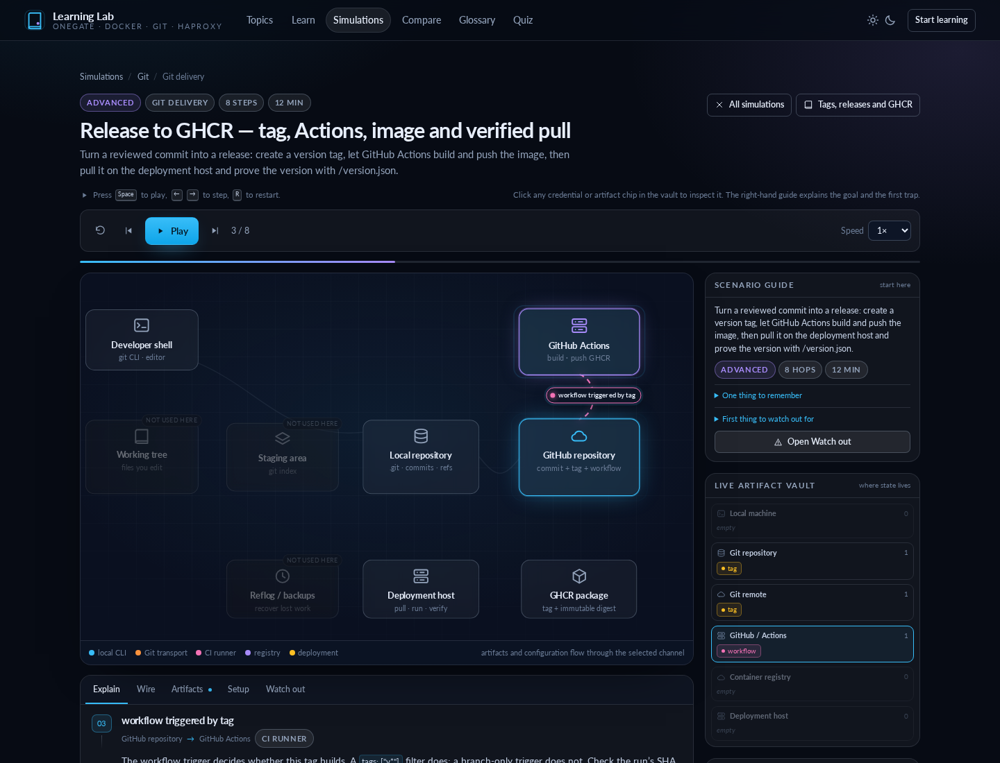
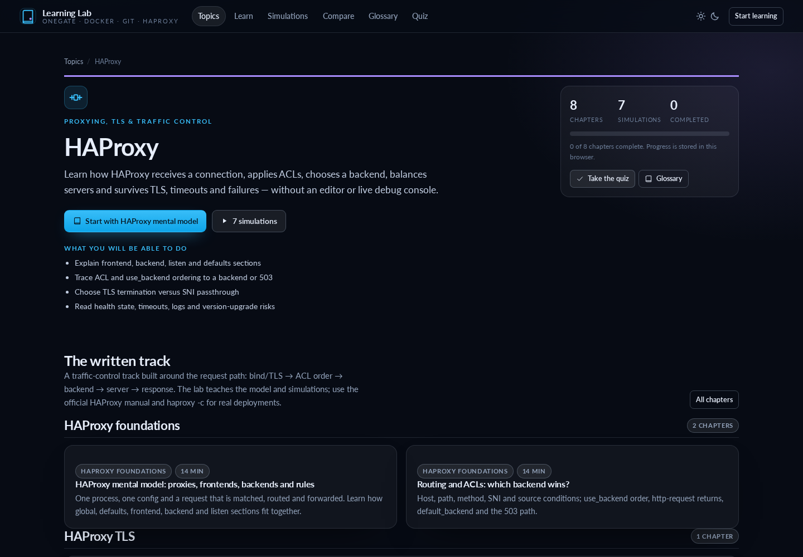
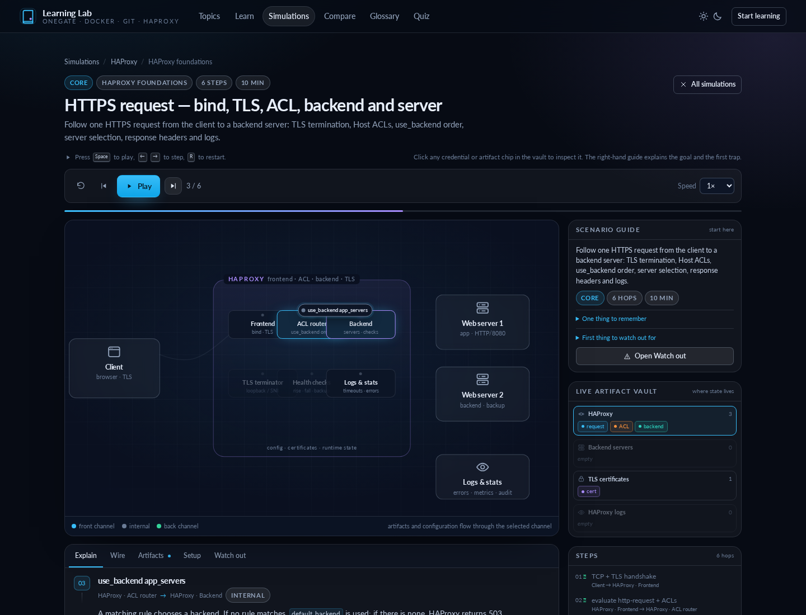
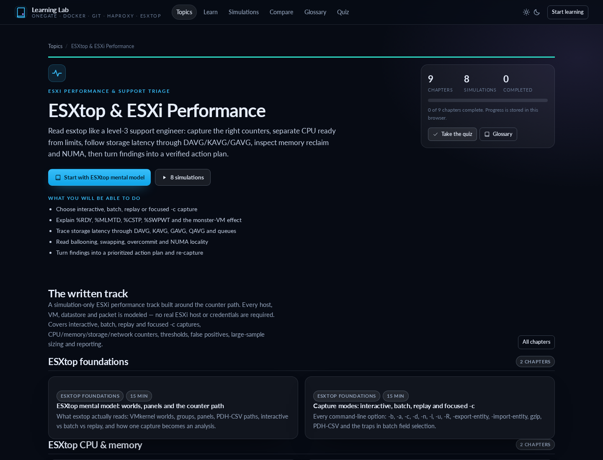
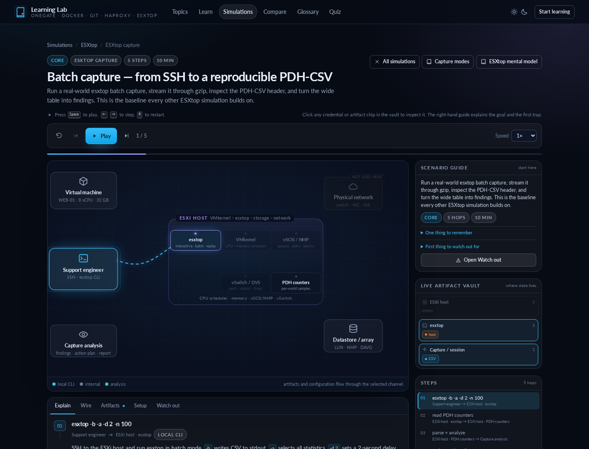

# Learning Lab

[](https://github.com/RogerBergling/Learning/actions/workflows/ci.yml)

An interactive, offline learning platform for **OneGate federation, Docker on Linux, Git & GHCR, HAProxy and ESXi performance**. Choose a track, read the chapters, run the animated simulations and verify each flow step by step.

**Five learning tracks. Forty-eight written chapters. Forty-six animated simulations. A 41-question quiz with local progress.** No build step, no runtime dependencies; once the image or files are present, the lab runs offline.

```text
Topics → chapters → simulations → live artifact vault → quiz
```

## The easy way

**You only need Docker.** No clone, Python, Node or build step. The Compose file is the only file you download.

```bash
curl -O https://raw.githubusercontent.com/RogerBergling/Learning/main/compose.yaml
docker compose up -d
```

Open **<http://localhost:8003>** and pick a track.

- Read a chapter or jump straight into a simulation.
- Every token, container, commit, proxy and ESXi counter is simulated.
- Progress stays in your browser.

Stop it with `docker compose down`. The container runs read-only, drops Linux capabilities and does **not** mount the Docker socket.

If the image pull is denied, the GHCR package is still private: make it public once under **Packages → learning → Package settings → Change visibility → Public**, or run `docker login ghcr.io`.

**No Docker?** Clone the repository and run `./start.sh` (or `python3 start.py`) with Python 3.8+. See [Detailed setup](#detailed-setup) for local, Windows, Node, source-build and operational details.

## Screenshots

| Topic hub | Docker track |
|---|---|
|  |  |

| Docker simulator | Git & GHCR simulator |
|---|---|
|  |  |

| HAProxy track | HAProxy simulator |
|---|---|
|  |  |

| ESXtop track | ESXtop simulator |
|---|---|
|  |  |

More screenshots: [Git & GHCR track](docs/screenshots/git-topic.png) · [Docker quiz](docs/screenshots/docker-quiz.png).

All screenshots are captured from the running site with simulated data.

---

## Detailed setup

Use this section when you need local Python, Windows, the optional Node launcher, a source build, GHCR publishing details or deployment verification.

### Docker (published image)

The repository includes a ready-to-use [`compose.yaml`](compose.yaml). It pulls the published multi-arch image, publishes the lab on port **8003**, keeps the version stamp visible, and uses explicit pull/recreate updates.

```bash
curl -O https://raw.githubusercontent.com/RogerBergling/Learning/main/compose.yaml
docker compose up -d
```

Open **<http://localhost:8003>**. No Python, Node or clone is required.

If the first `docker compose up` gets an authentication error, the GHCR package is still private. Make it public once in **Packages → learning → Package settings → Change visibility → Public**, or authenticate the host with `docker login ghcr.io`.

Update to the newest published image:

```bash
docker compose pull
docker compose up -d --force-recreate
curl -s http://localhost:8003/version.json | python3 -m json.tool
```

If the version, commit or build date does not change, the host is still running the old container or the image was not pulled.

### Linux / macOS

```bash
./start.sh
```

or:

```bash
python3 start.py
```

### Windows

Double-click **`start.bat`**, or from a terminal:

```bat
py -3 start.py
```

The launcher serves `public/` on the first free port in **8080–8099** and opens your browser. Stop it with `Ctrl+C`.

```bash
python3 start.py --no-browser     # serve without opening a browser
python3 start.py --port 8080      # try 8080 first
python3 start.py --host 0.0.0.0   # reachable from the LAN (be deliberate)
```

**Requirement:** Python 3.8+ (stdlib only). No `pip install`.

### Optional Node launcher

If you have Node 18+ but not Python:

```bash
npm start
# or
node server.mjs --port 8080 --no-browser
```

The Python launcher is the primary path; both serve exactly the same static files.

> Open the site through the server, not as a `file://` URL. ES modules and the Markdown chapters are fetched over HTTP.

### Build the image from source

The image contains only the static site and the Python stdlib launcher:

```bash
docker build -t learning-lab .
docker run --rm -p 8080:8080 learning-lab
```

Open <http://localhost:8080>. The container runs as an unprivileged user and listens on port 8080.

### Docker Compose details

Users only need [`compose.yaml`](compose.yaml); the Docker commands above download and start it. The file defines the published image, port `8003:8080`, read-only/capability hardening, resource limits and restart policy. It deliberately does **not** mount the Docker socket.

Stop it with `docker compose down`.

The GHCR package must be public for anonymous pulls, or the user must run `docker login ghcr.io` first. A new GHCR package is private by default even when the repository is public; make it public once under **Packages → learning → Package settings → Change visibility → Public**, or grant `read:packages` to the server.

Updates are explicit:

```bash
docker compose pull
docker compose up -d --force-recreate
```

This avoids mounting `/var/run/docker.sock` into an updater. Socket access is effectively root-equivalent control of the Docker host, so the Compose file intentionally has no automatic in-place updater. Verify the image digest and `/version.json` after each update.

### Automatic publishing to GitHub Container Registry

[`.github/workflows/docker-publish.yml`](.github/workflows/docker-publish.yml) runs on every push, and manually from **Actions → Publish Docker image → Run workflow**. It builds `linux/amd64` and `linux/arm64` images and pushes them to GHCR:

```text
ghcr.io/rogerbergling/learning
```

No repository secrets are required: the workflow authenticates with the built-in `GITHUB_TOKEN`.

| Trigger | Image tags |
|---|---|
| Push to `main` | `latest`, `main`, `sha-<short>` |
| Push to another branch | `<branch>`, `sha-<short>` |
| Push a tag such as `v1.2.0` | `v1.2.0`, `sha-<short>` |
| Manual run | Tags for the selected ref |

Pull and run the published image:

```bash
docker pull ghcr.io/rogerbergling/learning:latest
docker run --rm -p 8080:8080 ghcr.io/rogerbergling/learning:latest
```

**First-time checklist**

1. Commit and push these files. The first workflow run creates the package automatically.
2. Make sure Actions is enabled (**Settings → Actions → General**). If your organization restricts package creation, allow GitHub Actions to publish packages.
3. A new GHCR package is private by default. To allow anonymous pulls, open the package → **Package settings** → **Change visibility** → **Public**.
4. To pull a private image locally, authenticate with a token that has `read:packages`:

   ```bash
   echo "$CR_PAT" | docker login ghcr.io -u YOUR_GITHUB_USERNAME --password-stdin
   ```

   `GITHUB_TOKEN` only works inside Actions; locally, use a personal access token with package read permission.

If you meant Docker Hub rather than GHCR, the same workflow can also push there after adding `DOCKERHUB_USERNAME` and `DOCKERHUB_TOKEN` secrets and a Docker Hub login step.

### Version and deployment status

The home page shows a deployment stamp:

- **Version** — the application version from `package.json`
- **Image** — the Docker tag/ref produced by the publish workflow
- **Commit** — the short Git SHA baked into the image
- **Built** — the UTC build timestamp
- **Local time** — a live clock in the visitor's browser

The same version, image tag, commit and build date appear in the footer of every page. The raw metadata is available at:

```text
/version.json
```

Local development serves the committed fallback:

```json
{
  "version": "2.2.0",
  "imageTag": "local",
  "commit": "local",
  "buildDate": null
}
```

The Docker build overwrites that file with real build metadata. The publish workflow passes `APP_VERSION` from `package.json`, `IMAGE_TAG` from the generated image metadata, `GIT_SHA`, and a UTC `BUILD_DATE` as Docker build arguments.

To verify that a web server has pulled the newest image:

```bash
curl -s http://YOUR_HOST:8003/version.json | python3 -m json.tool
```

Compare that output with the image labels:

```bash
docker inspect ghcr.io/rogerbergling/learning:latest \
  --format '{{index .Config.Labels "io.onegate.build.version"}} {{index .Config.Labels "io.onegate.build.image-tag"}} {{index .Config.Labels "io.onegate.build.revision"}} {{index .Config.Labels "io.onegate.build.date"}}'
```

If the page still shows an old commit or build date, the host is still running an old container image or the browser is serving a cached page. The launchers send `Cache-Control: no-store`; the version fetch also uses `no-store`.

For a manual Docker build, stamp it explicitly:

```bash
docker build \
  --build-arg APP_VERSION=2.2.0 \
  --build-arg IMAGE_TAG=manual \
  --build-arg GIT_SHA="$(git rev-parse --short HEAD)" \
  --build-arg BUILD_DATE="$(date -u +%Y-%m-%dT%H:%M:%SZ)" \
  -t learning-lab .
```

---

## What is in the lab

| Page | What it does |
|---|---|
| **Topics** (`#/`) | Choose OneGate federation, Docker on Linux, Git & GHCR, HAProxy or ESXtop |
| **Topic pages** (`#/topic/{id}`) | A guided path, chapter groups, simulations, progress and glossary for one track |
| **Learn** (`#/learn`) | Forty-eight chapters across five tracks, full-text search, TOC and completion tracking |
| **Simulations** (`#/scenarios`) | Filter/search all 46 flows by topic, category, level, tag or keyword |
| **Simulator** (`#/sim/{id}`) | Animated stage, live artifact vault, HTTP/CLI wire view, config and pitfalls |
| **Compare** (`#/compare`) | JWT vs opaque, the storage matrix and a decision helper |
| **Glossary** (`#/glossary`) | OneGate terms; Docker, Git, HAProxy and ESXtop tracks have their own glossaries |
| **Quiz** (`#/quiz`) | A 41-question knowledge check across the tracks, with saved progress |
| **Self-check** (`#/selftest`) | Runtime validation of topics, scenarios, tokens, quizzes and all docs |

Every scenario has five tabs:

- **Explain** — the current hop, actors, channel, a “What to notice” rule, tags and the full token journey.
- **Wire** — the HTTP request/response, shell command or output shape for the hop.
- **Tokens / artifacts** — decode simulated JWTs/entity statements, inspect tokens, images, commits, Compose files and other artifacts.
- **Setup** — the OneGate configuration behind the flow, plus design notes.
- **Watch out** — troubleshooting for the current hop, common traps and a before-production checklist.

The right rail adds a **Scenario guide** (goal, one thing to remember, first trap), the **live artifact vault** and the **step list**.

Keyboard: `Space` play/pause, `←` `→` step, `R` restart. Click any vault chip to inspect a token, image, commit, configuration or other artifact.

---

## The scenarios

### Setup walkthrough

| # | Scenario | Level | Steps | Teaches |
|---|---|---|---|---|
| 1 | Control Center setup | Core | 15 | Virtual Host Selector, Local Provider, Remote Client, RP, BFF, Web Resource + ACL, attribute source, Activate Changes |

### Foundations

| # | Scenario | Level | Steps | Teaches |
|---|---|---|---|---|
| 2 | [Client credentials](public/docs/09-scenario-catalog.md) | Core | 8 | A service authenticates with client ID + secret; no user, no refresh token. The manual does not document this grant |
| 3 | [JWT vs opaque](public/docs/07-tokens-and-lifecycle.md) | Core | 7–8 | Local validation vs introspection; revocation, latency, disclosure. The manual mentions introspection only as claim context; no endpoint is documented |

### Browser apps

| # | Scenario | Level | Steps | Teaches |
|---|---|---|---|---|
| 4 | Public SPA — Authorization Code + PKCE | Core | 13 | A public client logs in safely; the token still reaches JavaScript |
| 5 | Confidential web app | Core | 17 | Server-side code flow; browser gets only a session cookie |
| 6 | BFF login | Core | 19 | OneGate as OP **and** RP; cookie + CSRF; tokens stay server-side |
| 7 | Legacy app behind the proxy | Core | 10 | Web Resource + normal auth + ACL; configured `X-USERID`; no app changes |

### Tokens, sessions and delegation

| # | Scenario | Level | Steps | Teaches |
|---|---|---|---|---|
| 8 | Refresh token rotation | Advanced | 10 | Rotate on use; reuse detection; invalidate the set |
| 9 | Multi-audience | Advanced | 12 | One login, one token per API; `aud` and resource indicators |
| 10 | Logout | Core | 10 | Local session, OP session, partner session, revocation caveats |
| 11 | BFF with a partner IdP | Advanced | 18 | The same BFF, federated; local user mapping; reject vs JIT |
| 12 | BFF exchange | Advanced | 13 | Delegation with `sub` + `act`; never trust `requested_subject` |

### Federation, SAML and attributes

| # | Scenario | Level | Steps | Teaches |
|---|---|---|---|---|
| 13 | Federation in — OneGate as RP | Advanced | 16 | Validate a partner ID token, map the user, enrich, create a local session |
| 14 | Federation in — OneGate as SAML SP | Advanced | 11 | Validate an inbound assertion; link the identity |
| 15 | Federation out — OneGate as SAML IdP | Advanced | 11 | Issue a signed assertion to a partner SP |
| 16 | Attribute source (REST) | Core | 16 | Lookup at issuance, `realm`/`subject`/`requested_attributes`, caching, claims mapping |
| 17 | Delegated attributes | Advanced | 14 | The `actor` object; cache keyed by subject + actor |
| 18 | [OpenID Federation](public/docs/12-openid-federation.md) | Advanced | 12–16 | Entity statements, trust anchors, trust chains, metadata policy and automatic registration. Standards-based; not documented in the OneGate manual |

### Docker on Linux

| # | Scenario | Level | Steps | Teaches |
|---|---|---|---|---|
| 19 | Docker run — image to container | Core | 10 | CLI → Engine, registry pull, ports, bridge network, volume, logs, exec, stop/remove |
| 20 | Docker build | Core | 8 | Dockerfile, build context, `.dockerignore`, layers/cache, push and deploy |
| 21 | Docker Compose | Core | 9 | Services, network, volume, resource limits and explicit updates |
| 22 | Docker operations | Advanced | 9 | Logs, exec, inspect, stats, events, disk use and safe cleanup |
| 23 | Docker security | Advanced | 8 | Non-root, read-only, capabilities, limits and runtime verification |
| 24 | GHCR delivery | Advanced | 7 | Tags, digests, package access, explicit pull/recreate and the version stamp |

### Git & GHCR

| # | Scenario | Level | Steps | Teaches |
|---|---|---|---|---|
| 25 | First repository | Core | 8 | init, index, review, signed commit, remote, first push |
| 26 | Branches and merge | Core | 7 | Branch refs, fast-forward, merge commit, safety refs |
| 27 | Rebase | Advanced | 7 | Fetch, divergence, safety ref, replay, force-with-lease and merge-vs-rebase |
| 28 | Undo and recovery | Advanced | 7 | Restore, soft reset, revert, reflog and stash |
| 29 | Secrets and history | Advanced | 8 | Ignore rules, scanning, rotation and coordinated history rewrite |
| 30 | Remotes and auth | Core | 7 | SSH, `gh auth`, fetch, fast-forward, rejected push and upstream |
| 31 | Release to GHCR | Advanced | 8 | Tag, Actions, image digest, deployment pull and `/version.json` |

### HAProxy

| # | Scenario | Level | Steps | Teaches |
|---|---|---|---|---|
| 32 | HTTPS request | Core | 6 | Frontend bind/TLS, ACL, backend selection, server and logs |
| 33 | ACL routing | Core | 7 | First-match order, default backend and the 503 path |
| 34 | TLS termination and SNI | Advanced | 9 | Termination vs passthrough, loopback terminator and forwarded headers |
| 35 | Health checks and balancing | Core | 7 | check/rise/fall, backup servers, 502/503/504 |
| 36 | Timeouts and logs | Advanced | 7 | queue/connect/server timeouts, 504 and timer diagnosis |
| 37 | Security | Advanced | 7 | TLS, headers, client certificates, admin socket and trust boundaries |
| 38 | Operations and upgrades | Advanced | 7 | `haproxy -c`, reload, rollback and 2.8 → 3.x changes |

### ESXtop & ESXi performance

| # | Scenario | Level | Steps | Teaches |
|---|---|---|---|---|
| 39 | Batch capture | Core | 5 | SSH → `-b -a -d -n` → gzip → PDH-CSV → findings |
| 40 | CPU ready | Core | 5 | `%RDY`, `%MLMTD`, `%CSTP`, monster VM and the limit-vs-contention decision |
| 41 | Memory reclaim | Core | 5 | `MCTLSZ`, `SWCUR`, swap rates, overcommit and `N%L` |
| 42 | Storage latency | Advanced | 5 | vSCSI → NMP → HBA/LUN, `DAVG`, `KAVG`, `GAVG`, queues |
| 43 | Storage queue | Advanced | 4 | `QUED`, `ACTV`, `%USD`, `DQLEN`/`AQLEN`, aborts/resets |
| 44 | Network drops | Core | 4 | `%DRPTX`/`%DRPRX`, uplink, physical switch, host CPU |
| 45 | Focused rc | Advanced | 4 | `W`, `-c`, panel letters, no Datastore panel, large-sample sizing |
| 46 | Triage and report | Advanced | 5 | System worlds, P95/P05, action plan, HTML/PDF hand-off |

Every scenario is reachable from the Simulations page and from the written chapters. The OneGate catalog with “start here if…” guidance is in [chapter 9](public/docs/09-scenario-catalog.md). The HAProxy track is a learning path only — there is no config editor or active debug console. The ESXtop track is simulation-only: it does not connect to an ESXi host, run esxtop, or change a real VM.

---

## OneGate track — the big picture

```
        untrusted                              trusted network
 ┌──────────────────┐        ┌──────────────────────────────┐        ┌─────────────────┐
 │  Browser / user  │───────▶│            OneGate           │───────▶│ Frontend server │
 │                  │◀───────│  proxy · OP · RP · BFF       │◀───────│ (SPA host / app)│
 └──────────────────┘        │  token handler · attr client │        └─────────────────┘
         │                   └───────┬──────────────┬───────┘
         │                    ┌──────▼──────┐  ┌────▼─────────┐
         │                    │ Local OP    │  │ Backend API  │
         │                    │ (issues)    │  │ (validates)  │
         │                    └─────────────┘  └──────────────┘
         │                           │
         │                    ┌──────▼──────────────┐
         └───────────────────▶│ Partner IdP / SP    │
              federation      │ Entra · SAML · OIDC │
                              └─────────────────────┘
```

**The surprising part:** in the BFF flow OneGate talks to itself. The BFF uses an RP configuration; that RP's remote provider is OneGate's own Local Provider. Same protocol, same validation, no privileged shortcut. That is why the simulator wires `BFF → RP → OP` inside the same box.

Read [chapter 1](public/docs/01-architecture.md) for the trust boundaries and the five roles.

---

## Where tokens are allowed to live

| Credential | Browser | OneGate | Frontend / BFF | Backend API |
|---|---|---|---|---|
| Authorization code | One hop | Creates/consumes | Exchanges | Never |
| Access token (JWT) | SPA only, in memory | Yes | Yes | Validate, don't store |
| Access token (opaque) | SPA only, in memory | Yes | Yes | Introspect |
| Refresh token | **Never** | Yes | Confidential server only | Never |
| ID token | SPA briefly | Yes (RP) | Yes | **Never** |
| BFF cookie | Yes (HttpOnly) | Yes | No | No |
| Client secret | **Never** | Yes | Yes (confidential) | Only if it is the client |
| SAML assertion | One POST | Yes | No | No |
| CSRF token | Yes (readable) | Yes | Yes | No |

Two rules prevent most incidents:

1. **If JavaScript can read it, assume it will leak.**
2. **A cookie is not a token.** It points at server-side state and carries no claims.

The [Compare page](#/compare) has the full matrix and a JWT-vs-opaque decision helper. Every simulation's live vault shows the same information for the flow you are watching.

---

## Client ID vs client secret

`client_id` identifies the application and is not secret. `client_secret` authenticates a **confidential** client at the token endpoint. If the component cannot keep a secret, it must not have one.

| Scenario | Client ID | Client secret | Why |
|---|---|---|---|
| SPA | Yes | **No** | JavaScript is public; use PKCE or a BFF |
| Mobile app | Yes | **No** | The binary is inspectable; use the system browser + PKCE |
| Native desktop app | Yes | **No** | Same rule; never ship a secret |
| BFF | Yes | Yes | Server-side secret and tokens; browser gets a cookie |
| Reverse proxy / token handler | Yes (if OAuth client) | Yes (if OAuth client) | Only if it actually acts as an OAuth client |
| Traditional web app | Yes | Yes | Server-side code flow |
| Client credentials flow | Yes | Yes (or stronger) | A service authenticates itself |

> **OneGate Web Resource note.** A plain **Web Resource** proxy is not an OAuth client: it uses normal authentication + ACL + configured custom headers. If a proxy also acts as a BFF/token handler, it is a confidential client.
>
> **Manual caveat.** The OneGate Administration Manual does not document the client-credentials grant. Treat that row as generic OAuth 2.0 background and verify support in your version.

**Ask yourself: can this component safely store a secret?** Browser → no. Mobile app → no. Desktop app → no. Server-side web app/BFF/token handler → yes. If no, use PKCE or a BFF. “No shared secret” does not mean “no client authentication”: a client can use `private_key_jwt` or mTLS instead.

Full definitions of SPA, traditional web app, BFF, mobile, native desktop, reverse proxy/token handler and service clients are in [chapter 2](public/docs/02-oidc-basics.md).

---

## Written chapters

All in [`public/docs/`](public/docs/), rendered by the site and readable on GitHub:

| # | Chapter | What it covers |
|---|---|---|
| 1 | [The big picture](public/docs/01-architecture.md) | Topology, five roles, trust boundaries, OneGate talking to itself |
| 2 | [OIDC & OAuth 2.0](public/docs/02-oidc-basics.md) | Roles, SPA/mobile/native/BFF/web/service clients, client_id vs client_secret, code flow, PKCE, JWT anatomy |
| 3 | [Configuring the OpenID Provider](public/docs/03-onegate-local-provider.md) | Local Providers, Realm Settings, Remote Clients, keys, a worked registration |
| 4 | [Federation: RP, SAML IdP, SAML SP](public/docs/04-federation-rp-saml.md) | Inbound OIDC, user mapping, assertions, NameID, validation |
| 5 | [Backend for Frontend](public/docs/05-bff.md) | Cookie/CSRF model, self-OP/RP, exchange, logout, the debug trap |
| 6 | [Attribute sources & the User Attribute API](public/docs/06-attribute-providers.md) | LDAP/REST/Graph, subject/actor/ext, access tokens, JsonPath, caching, delegation |
| 7 | [Tokens, storage and lifetimes](public/docs/07-tokens-and-lifecycle.md) | JWT vs opaque, storage, rotation, revocation, logging |
| 8 | [Server-to-server](public/docs/08-server-to-server.md) | Client credentials, secret rotation, audience design, exchange |
| 9 | [Scenario catalog](public/docs/09-scenario-catalog.md) | Every simulation, how to read the stage, suggested routes |
| 10 | [Troubleshooting](public/docs/10-troubleshooting.md) | Error codes, cookies, CORS, clocks, JWKS, SAML, a triage checklist |
| 11 | [The Control Center, end to end](public/docs/11-control-center.md) | Virtual Host Selector, Monitoring, Administration, Server/Auth/Federation, Activate Changes, manual caveats |
| 12 | [OpenID Federation](public/docs/12-openid-federation.md) | Entity statements, trust chains, metadata policy, trust marks, automatic registration — standards-based, not a OneGate manual feature |
| — | [Glossary](public/docs/glossary.md) | Every acronym in the lab |

### Docker track

| Chapter | What it covers |
|---|---|
| [Mental model](public/docs/docker-01-mental-model.md) | CLI, daemon, image, container, registry, namespaces and persistence |
| [Images and builds](public/docs/docker-02-images-and-builds.md) | Dockerfile, context, `.dockerignore`, layers, cache, multi-stage, GHCR |
| [Container lifecycle](public/docs/docker-03-containers-lifecycle.md) | run/ps/logs/exec/inspect/stop/rm, ports, restart policy, healthchecks |
| [Storage and networking](public/docs/docker-04-storage-networking.md) | Named volumes, bind mounts, bridge networks, DNS, published ports |
| [Compose](public/docs/docker-05-compose.md) | Every line of the provided `compose.yaml`, resources and explicit updates |
| [Operations and security](public/docs/docker-06-operations-security.md) | Debugging, cleanup, daemon settings, rootless, capabilities, secrets |
| [GHCR and updates](public/docs/docker-07-ghcr-and-updates.md) | Tags, digests, package visibility, pull/recreate, version verification |
| [Docker glossary](public/docs/docker-glossary.md) | Every Docker term used in the track |

### Git & GHCR track

| Chapter | What it covers |
|---|---|
| [Mental model](public/docs/git-01-mental-model.md) | Working tree, index, commits, refs, graph, HEAD, fetch vs pull |
| [First repository](public/docs/git-02-first-repository.md) | Identity, defaults, init, staging, commit, remote and first push |
| [Everyday workflow](public/docs/git-03-everyday-workflow.md) | Status, stage, diff, commit, log and safe review |
| [Branches, merge and rebase](public/docs/git-04-branches-merge-rebase.md) | Fast-forward, merge commits, rebase safety and conflicts |
| [Undo and recovery](public/docs/git-05-undo-recovery.md) | Restore, reset, revert, reflog, stash and amend |
| [Remotes and GitHub](public/docs/git-06-remotes-github.md) | Origin/upstream, SSH, `gh auth`, divergence, PRs and protection |
| [Settings, files and secrets](public/docs/git-07-settings-files-secrets.md) | Global settings, `.gitignore`, signing, `.env` and history scanning |
| [Tags, releases and GHCR](public/docs/git-08-tags-releases-ghcr.md) | Tags, releases, GitHub Actions, image digests and verification |
| [Git glossary](public/docs/git-glossary.md) | Every Git/GHCR term used in the track |

### HAProxy track

| Chapter | What it covers |
|---|---|
| [Mental model](public/docs/haproxy-01-mental-model.md) | Frontend, backend, listen, global/defaults, request pipeline and modes |
| [Routing and ACLs](public/docs/haproxy-02-routing-acls.md) | ACL order, use_backend, default backend, 503 and negative tests |
| [TLS and SNI](public/docs/haproxy-03-tls-and-sni.md) | Termination, passthrough, loopback terminator and forwarded headers |
| [Health and balancing](public/docs/haproxy-04-health-balancing.md) | check/rise/fall, algorithms, backups and 502/503/504 |
| [Timeouts and logging](public/docs/haproxy-05-timeouts-logging.md) | Queue/connect/server timers, logs, stats and diagnosis |
| [Security](public/docs/haproxy-06-security.md) | TLS policy, headers, client certificates and admin-plane exposure |
| [Operations and upgrades](public/docs/haproxy-07-operations-upgrades.md) | `haproxy -c`, reload, rollback, 2.8 → 3.x and observability |
| [HAProxy glossary](public/docs/haproxy-glossary.md) | Every HAProxy term used in the track |

### ESXtop & ESXi performance track

| Chapter | What it covers |
|---|---|
| [Mental model](public/docs/esxtop-01-mental-model.md) | Worlds, groups, panels, PDH-CSV, interactive/batch/replay and the counter path |
| [Capture modes](public/docs/esxtop-02-capture-modes.md) | `-b`, `-a`, `-c`, `-d`, `-n`, `-l`, `-u`, `-R`, gzip and capture quality |
| [CPU scheduling](public/docs/esxtop-03-cpu-scheduling.md) | `%RDY`, `%MLMTD`, `%CSTP`, `%SWPWT`, monster VMs and the decision tree |
| [Memory and NUMA](public/docs/esxtop-04-memory-numa.md) | Ballooning, VMkernel swap, compression, overcommit, `N%L`, `NRMEM` |
| [Storage latency](public/docs/esxtop-05-storage-latency.md) | `DAVG`, `KAVG`, `GAVG`, `QAVG`, queues, paths, aborts/resets and datastore mapping |
| [Network and vSAN](public/docs/esxtop-06-network-vsan.md) | TX/RX drops, packet size, throughput, uplinks, vSAN and power/interrupt context |
| [Focused captures](public/docs/esxtop-07-focused-capture.md) | `W`, rc file format, panels, storage bundles, large-sample sizing and limits |
| [Triage and reporting](public/docs/esxtop-08-triage-reporting.md) | P95/P05, system worlds vs VMs, action plans, change control and HTML/PDF reports |
| [Counter reference](public/docs/esxtop-09-counter-reference.md) | Full CPU/memory/storage/network/vSAN counter map, thresholds, status semantics, field coverage and report scope |
| [ESXtop glossary](public/docs/esxtop-glossary.md) | Every ESXi performance term used in the track |

Primary sources: [Yellow Bricks — ESXTOP](https://www.yellow-bricks.com/esxtop/) · [Broadcom 344099 — storage performance](https://knowledge.broadcom.com/external/article/344099) · [Broadcom 1008205](https://knowledge.broadcom.com/external/article?legacyId=1008205) · [Broadcom 326309 — exporting esxtop data](https://knowledge.broadcom.com/external/article/326309/exporting-esxtop-performance-data-as-a-c.html) · [vSphere 8.0 monitoring and performance](https://techdocs.broadcom.com/us/en/vmware-cis/vsphere/vsphere/8-0/vsphere-monitoring-and-performance.html).

The Markdown is the single source of truth: the site fetches and renders the same files you read on GitHub.

---

## Project structure

```
Learning/
├── .github/workflows/
│   ├── ci.yml                   Static checks, HTTP smoke test + JS syntax
│   └── docker-publish.yml       Build + push the image to GHCR on every push
├── .github/dependabot.yml       Monthly updates for actions + base image
├── public/
│   ├── index.html               App shell and navigation
│   ├── assets/
│   │   ├── css/app.css           Design system, simulator, responsive, print
│   │   └── js/
│   │       ├── app.js            Hash router, theme, doc loader
│   │       ├── content.js        Topics, chapters, categories and paths
│   │       ├── markdown.js       Dependency-free Markdown renderer + TOC
│   │       ├── progress.js       Local-only chapter/quiz progress
│   │       ├── quiz-data.js      Quiz questions, answers and explanations
│   │       ├── search.js         Full-text chapter index and snippets
│   │       ├── tokens.js         Simulated JWTs, stores, token kinds
│   │       ├── ui.js             Icons, toast, helpers
│   │       ├── version.js        Build metadata + local clock formatting
│   │       ├── pages/            Home, topic, learn, list, simulator, quiz, compare, selftest
│   │       ├── scenarios/        Forty-six scenario definitions + helpers
│   │       └── sim/              Layout geometry + the animation player
│   ├── version.json              Local fallback; overwritten by Docker build
│   └── docs/                     Forty-eight Markdown chapters across five tracks
├── scripts/
│   ├── verify.py                 Dependency-free static registry/link checks
│   └── smoke.py                  Starts start.py and checks real HTTP responses
├── docs/screenshots/             README screenshots from the running site
├── Dockerfile                    Container image (Python static server)
├── .dockerignore                 Keeps the build context small
├── compose.yaml                  Compose stack with explicit pull/recreate updates
├── start.py                     Python stdlib server (primary launcher)
├── start.sh                     Linux/macOS launcher
├── start.bat                    Windows launcher
├── server.mjs                   Optional Node launcher
├── package.json                 `npm start` (type: module, no dependencies)
├── CONTRIBUTING.md              Scenario, chapter and launcher conventions
├── LICENSE                       MIT license
└── README.md
```

No bundler, no framework, no runtime dependency. The browser loads ES modules directly.

---

## How the simulation works

- A fixed **1000 × 600** virtual topology per scenario layout (`onegate`, `docker`, `git`, `haproxy`, `esxtop`). Nodes are HTML positioned in percentages; wires are SVG paths in the same coordinate space.
- A scenario is plain data: `{ id, topic, layout, title, category, level, minutes, summary, nodes, nodeLabels, initial, variants, steps, notes, config, pitfalls }`.
- A step is `{ from, to, badge, detail, channel, http, vault, tags }`.
- The vault is recomputed from `initial` plus every step's `vault` operations (`add`, `del`, `clearStore`), so it is always consistent with the current step.
- JWT values are built with a fake signature but real base64url header/payload, so the inspector can decode them.
- The **token journey** table is generated from the same vault operations.

To add a scenario, create a file in `public/assets/js/scenarios/`, export the object, and register it in `scenarios/index.js`. Add a `topic`, a `layout`, a flow line, a top-level `tags` array and, if you like, a chapter link. Run [Self-check](#/selftest) to validate the data.

---

## Verification

- **Static checks** (`python3 scripts/verify.py`) validate the document and scenario registries, quiz data, internal links, actors, token stores, assets, packaging metadata and server headers without a browser.
- **Smoke test** (`python3 scripts/smoke.py`) starts the real `start.py` launcher on a free port and checks the app shell, ES modules, Markdown, SPA fallback, 404 handling, `HEAD` and security headers.
- **Self-check** (`#/selftest`) validates scenario shape, actor IDs, channels, vault operations, token kinds, Markdown rendering and every doc fetch at runtime. It should report 100%.
- **curl** the routes: `/`, `/assets/js/app.js`, `/docs/01-architecture.md`, `/version.json` should be 200.
- Browser check: open `#/`, `#/topic/onegate`, `#/topic/docker`, `#/topic/git`, `#/topic/haproxy`, `#/topic/esxtop`, `#/learn/haproxy-07-operations-upgrades`, `#/learn/esxtop-08-triage-reporting`, `#/sim/haproxy-https-request`, `#/sim/esxtop-batch-capture`, `#/sim/esxtop-storage-latency`, `#/compare`, `#/quiz/haproxy`, `#/quiz/esxtop`, `#/glossary`, `#/selftest`.

Both checks use only the Python standard library and run in [`.github/workflows/ci.yml`](.github/workflows/ci.yml) on every push and pull request. The optional Node launcher is syntax-checked and smoke-tested separately.

If a chapter 404s, make sure you are serving `public/` (the launcher does) rather than opening `index.html` from disk.

---

## Notes and disclaimers

- **Everything is simulated.** Tokens, images, commits, container IDs, registry digests, hosts, captures and performance counters are illustrative. No request leaves your browser and no real infrastructure is touched.
- **Docker, Git and ESXtop examples are teaching paths.** Container names, ports, images, commits, hosts, captures and counter values are deliberately simple. Verify commands against your Docker/Compose, Git and ESXi versions before running them on a real host.
- **The Git track scope is informed by [`RogerBergling/git-create`](https://github.com/RogerBergling/git-create)**, a safe menu-driven Git/GitHub assistant. This lab teaches the concepts and safety decisions; the tool itself is not required.
- **Endpoint paths are illustrative.** Examples use `/mg-local/portal/...`, `/bff/login`, `/rp/callback`, `ONEGATE_BFF` and `X-CSRFTOKEN`. The Administration Manual names only `/mg-local/(realm)/bff/logout` and `/mg-local/(realm)/bff/accessToken`; the rest are examples. Real deployments generate their own paths, cookie names and menu labels; confirm them in your environment.
- **Menu names follow the OneGate Administration Manual.** The core objects are Local Providers, Realm Settings, Remote Clients, Remote Providers, RP Authentication, Backend For Frontend, Attribute Sources, Remote/Local Service Providers, Remote IDPs, Attribute Profiles, Access Control Lists (ACL), the Virtual Host Selector and Activate Changes. Labels can differ slightly between versions.
- **OpenID Federation is standards-based.** The OneGate Administration Manual does not document entity statements, trust anchors, trust chains or automatic registration. The new simulation and chapter explain OpenID Federation 1.0 as a standard, not as a claimed OneGate feature. Verify support in your version.
- **The manual is authoritative; generic OIDC is background.** The manual does not document the client-credentials grant, a token introspection endpoint, token revocation, OIDC back-channel logout, a public-client `none` auth method, a consent screen/policy, or a “PKCE required” switch. Where the lab uses one of these, it is labelled as generic OAuth/OIDC and marked “verify in your deployment”.
- **Earlier versions of this lab used “JVAP”.** That term does not appear in the manual. The feature is **Attribute Sources**; a REST source calls the **User Attribute API** contract. The lab now uses the manual’s terminology.
- **Checked against the vendor manual.** This edition was reviewed against the **OneGate Administration Manual**; the PDF is kept locally for reference and is not redistributed in the repository.
- **The HAProxy track scope is informed by [`RogerBergling/haproxy-gui`](https://github.com/RogerBergling/haproxy-gui)**, a local-first HAProxy configuration workbench. This lab teaches and simulates the concepts; it deliberately excludes the workbench editor and active debug console.
- **HAProxy is a registered trademark of HAProxy Technologies.** This lab is unofficial and is not affiliated with or endorsed by HAProxy Technologies. The HAProxy track is a teaching model, not a config editor, live debugger, deployment tool or replacement for `haproxy -c` and the official configuration manual.
- **The ESXtop track is simulation-only.** It does not connect to an ESXi host, run esxtop, collect a real capture, or change a VM. Every host, world, capture and counter is modeled. Counter semantics and thresholds are based on Broadcom/VMware documentation and Yellow Bricks field guidance; verify against your exact ESXi build. ESXi, ESXtop and VMware are trademarks of Broadcom. This lab is unofficial and not affiliated with Broadcom.
- The lab is an unofficial study aid, not affiliated with the vendor. It is not a substitute for the product documentation or a security review.
- No analytics, no external fonts, no CDN, no cookies. Chapter and quiz progress is stored in this browser's `localStorage` and never leaves the machine.

---

## License / use

Released under the [MIT License](LICENSE).

Use it for training, onboarding and design reviews. If you adapt it, keep the “simulated, not real credentials” warning visible — the whole point is to learn where tokens go without putting real ones anywhere.
